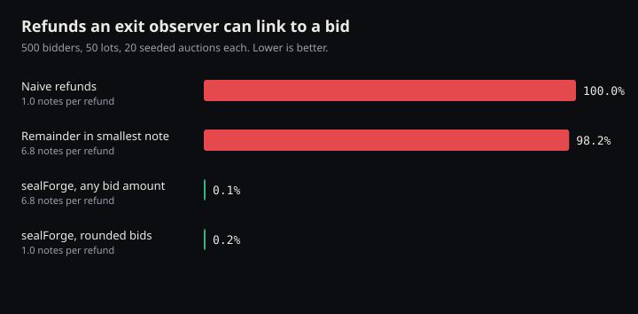

# Evidence: refund linkability (task 4.3, PRD AC13)

**Result:** with sealForge refunds, an observer who sees every refund exit can link **0.1%** of refunded bids, against **100%** for naive refunds. The PRD target was under 5%.



| Scenario | Linked | Notes per refund |
|---|---|---|
| Naive refunds (one exact refund per bidder) | 100.0% | 1.0 |
| Remainder in smallest note (earlier sealForge design) | 98.2% | 6.8 |
| **sealForge, any bid amount** (canonical notes, dust not sent) | **0.1%** | 6.8 |
| sealForge, rounded bids (bidder takes the rounding suggestion) | 0.2% | 1.0 |

500 bidders, 50 lots, uniform price, 20 seeded auctions per scenario. Bids are log-normal around 0.5 ZEC. Raw numbers: [linkability.json](linkability.json).

Reproduce:

```bash
cargo run -p sealforge-linkability --release -- --out docs/evidence
```

## What is measured

After close, the published viewing key reveals every bid's amount, so anyone can work out each bid's refund. The leak this harness measures is at the **exit**: when a bidder unshields or swaps refund money on a public chain (for example back to USDC through Intents), that amount is public.

- **Observer:** sees every exit event's value and tries to attribute each one to a bid.
- **Worst case for bidders:** every refund note is exited separately and immediately.
- **Linked:** a bid counts as linked when at least one of its notes has a value no other refund note in the auction has. The observer can then attribute that exit to that bid with certainty.

## What we learned

The first version of the refund planner added the sub-0.0001 ZEC remainder to the smallest note (PRD Q7's original default). That made one note per refund a unique value, and **98% of refunds were linkable**, barely better than naive refunds. sealForge now pays canonical notes only and doesn't send the dust (worth less than the fee for one note). Linkability dropped to 0.1% without asking bidders to round anything. The web form takes at most 4 decimals, so web bids have no dust at all.

Results at other sizes (same method):

| Bidders / lots | Naive | Remainder note | sealForge | Rounded bids |
|---|---|---|---|---|
| 100 / 10 | 100% | 99.4% | 0.4% | 0.7% |
| 500 / 50 | 100% | 98.2% | 0.1% | 0.2% |
| 2,000 / 200 | 100% | 93.6% | 0.0% | 0.0% |

## Limits, stated plainly

- **Timing is not modelled.** sealForge gives every note an independent random delay (10–240 min), so arrival time carries no per-bid signal. A bidder who exits all their notes in one go recreates the full refund amount and can be linked. The exit path (ShieldRamp, stretch) must warn about this.
- **Rare large notes can link.** A bid with an unusually large refund produces a large denomination that may be unique in a small auction. That is the residual 0.1–0.4%.
- **The bid amount itself is public after close.** This harness is about refunds. The published viewing key reveals each bid's amount and refund address (a fresh address), not who sent it.
