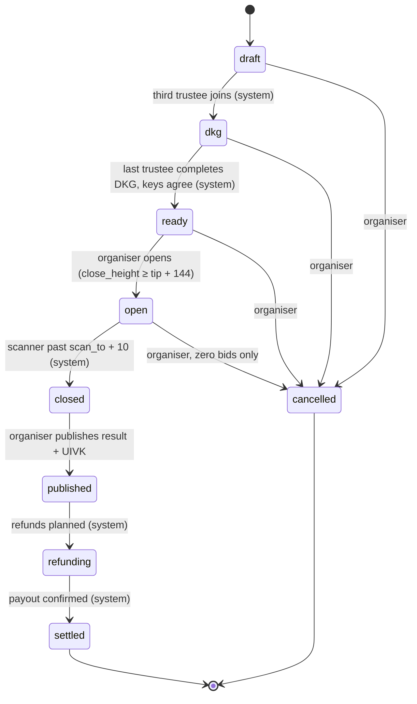
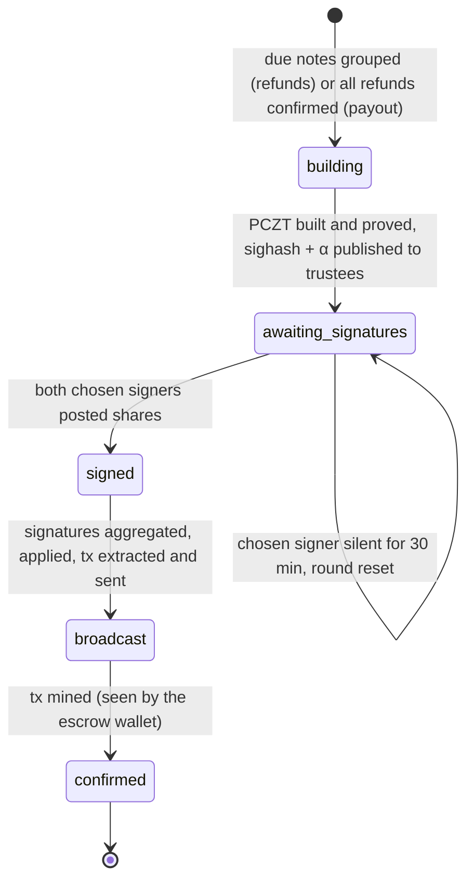

# 2.2 Lifecycle state machine

Status: `Testnet` (every transition below ran in `KE5DFF4PDA` and `K7GHHBC4GP`, except `cancelled`, which is `Tested`).

## Auction states

States are the Postgres enum `auction_status` in `migrations/20261007000000_init.sql`. Allowed transitions are `sealforge_coordinator::lifecycle::can_transition` (`crates/sealforge-coordinator/src/lifecycle.rs`).

| Transition | Actor | Trigger and rule | Code |
|---|---|---|---|
| `draft → dkg` | System | All three trustee slots joined | `routes/dkg.rs` `join` |
| `dkg → ready` | System | Every trustee reported the **same** public key package. The coordinator then derives the escrow FVK, UA and UFVK ([2.4](commitments.md), [3](../03-zcash-integration.md#escrow-key-construction)). A mismatch returns `409 dkg_mismatch` and the DKG must restart | `routes/dkg.rs` `complete` |
| `ready → open` | Organiser | Requires the escrow UA (`409 dkg_incomplete` otherwise) and `close_height ≥ tip + MIN_OPEN_BLOCKS`. `open_height` is set to the coordinator's chain tip at that moment | `routes/auctions.rs` `open`; `MIN_OPEN_BLOCKS = 144` in `crates/sealforge-coordinator/src/validate.rs` |
| `open → closed` | System | The escrow scanner has processed `scan_to + CLOSE_CONFIRMATIONS` blocks, where `scan_to` is `close_height` (deposit mode) or `reveal_close_height` (sealed-reveal). Then selection, clearing and the Merkle root are computed | `closer.rs` `close_auction`; `CLOSE_CONFIRMATIONS = 10` |
| `closed → published` | Organiser | Decrypts the UFVK, derives and stores the UIVK, exposes the result | `routes/auctions.rs` `publish` |
| `published → refunding` | System | Refund notes planned for every bid with a refund ≥ 10,000 zat and a usable refund address | `crates/sealforge-coordinator/src/refunds.rs` `plan_published` |
| `refunding → settled` | System | Every refund batch confirmed, then the payout batch confirmed | `scanner.rs` (settle step) |
| `* → cancelled` | Organiser | From `draft`, `dkg`, `ready`, or `open` with zero bids (`409 has_bids` otherwise) | `routes/auctions.rs` `cancel` |

`settled` and `cancelled` are terminal (`lifecycle::tests::terminal_states_have_no_exits`).

### Height rules

| Rule | Value | Where |
|---|---|---|
| Minimum bidding window | `close_height − tip ≥ 144` blocks at open. About 1 h at 25 s blocks, 3 h at 75 s | `validate.rs` `MIN_OPEN_BLOCKS`. Test networks MAY lower it with `SF_MIN_WINDOW_BLOCKS`; refused on mainnet (`config.rs`) |
| Bids count | `open_height ≤ h ≤ close_height` | `sealforge_core::selection::classify` ([2.5](selection.md)) |
| Reveal window (sealed-reveal) | `close_height < h ≤ reveal_close_height`, and `reveal_close_height ≥ close_height + 144` at creation | `selection::classify_commit_reveal`; `validate.rs` `reveal_window` |
| Close confirmations | Close runs only once the scanner has processed `scan_to + 10` | `closer.rs` `CLOSE_CONFIRMATIONS` |

**Why 10 confirmations.** Closing fixes the bid set, and the result is computed once. Waiting 10 blocks past the last counting height means a reorg shallower than 10 blocks can't add, drop or reorder an in-range payment after the result exists. 10 blocks is about 4 minutes at the 25 s testnet spacing and 12.5 minutes at 75 s. It is a policy choice, not a consensus finality bound. A deeper reorg after close is not handled ([11 Open questions](../11-open-questions.md)).

## Batch states

Each refund batch and the payout is a row in `tx_batches` with the enum `batch_status`.

| Step | Rule | Code |
|---|---|---|
| One in flight | At most one batch per auction is `awaiting_signatures`, `signed` or `broadcast` at a time | `scanner.rs` (the `in_flight` query) |
| Signer choice | The first two trustees to post round-1 commitments become the signer set, ordered by `submitted_at`, then slot | `routes/batches.rs` `advance` |
| Signer reset (SECURITY-REVIEW F4) | If the chosen signers haven't both posted shares within `SIGNING_TIMEOUT = 30 min` of selection, `signer_slots` and `signers_selected_at` are cleared and any two trustees can commit again. The CLI discards nonces from a reset round | `crates/sealforge-coordinator/src/refunds.rs` `SIGNING_TIMEOUT`; `routes/batches.rs` `reset_stalled`; `migrations/20261016000000_signer_timeout.sql` |
| Confirmation | `confirmed` when the escrow wallet reports the txid mined (one confirmation) | `scanner.rs`, `EscrowWallet::mined_height` |
| `failed` | Present in the enum and counted by `/readyz`, **but no code path sets it today**. A batch whose transaction expires unmined is not detected automatically | `migrations/20261007000000_init.sql`; [11 Open questions](../11-open-questions.md) |
