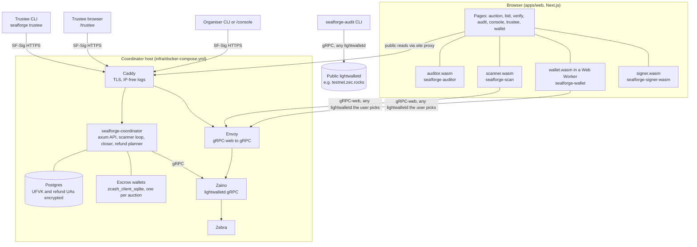
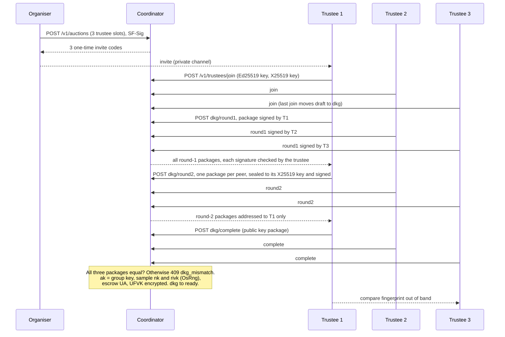
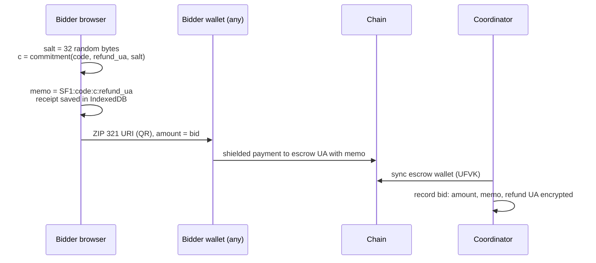
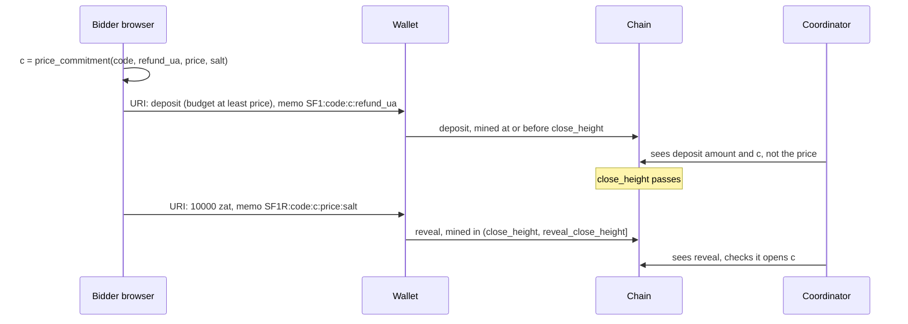
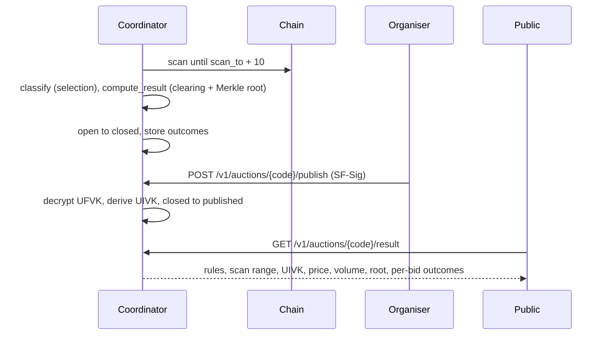
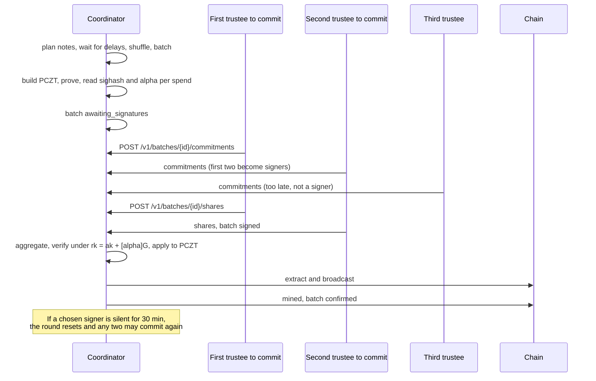
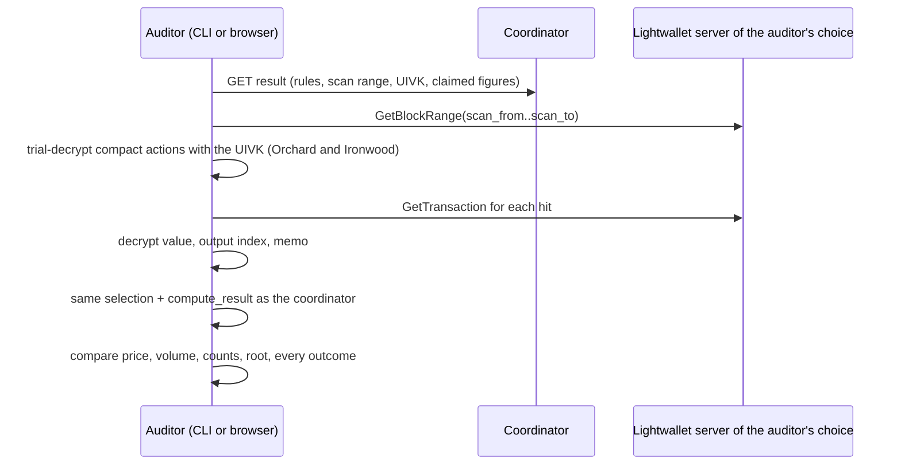

## Components



The trustees, the auditor and the bidder's wallet can each use a lightwallet server they choose. The coordinator's own Zaino is just the default.

## Crate and package map

**Pure** means no network or disk I/O, no clock and no randomness. Pure code is what an auditor has to read to trust a result, and it can run unchanged in the coordinator, a CLI and a browser.

| Crate / package | Pure? | Role |
|---|---|---|
| `sealforge-core` | **Yes** (rule in `crates/sealforge-core/src/lib.rs`) | Memos, commitments, selection, clearing, Merkle tree, ZIP 321, denominations, refund planning. Randomness for refund delays is injected by the caller |
| `sealforge-scan` | **Yes**: no I/O, no randomness | Trial-decrypts compact blocks and decrypts full transactions with a UIVK. Native and WASM |
| `sealforge-auditor` | **Yes**: no I/O in the library; the CLI binary does the network | Recomputes and compares a published result (`audit_chain`), checks receipts (`verify_receipt`). Library, `sealforge-audit` CLI, WASM |
| `sealforge-wallet` | No I/O (blocks are passed in), but **draws OS randomness** when building transactions | In-tab Ironwood wallet: keys, scanning, witnesses, PCZT payments. WASM |
| `sealforge-escrow` | No I/O. Randomness is passed in by the caller | FROST DKG, rerandomized signing, escrow FVK/UA/UFVK/UIVK |
| `sealforge-signer-wasm` | No I/O | Browser trustee: FROST round 1 and 2 over `(sighash, α)` |
| `sealforge-api` | No I/O | Shared request and response types, `SF-Sig` signing and verification |
| `sealforge-chain` | No | Escrow wallets (`zcash_client_sqlite`), PCZT building, broadcast, chain audit over gRPC |
| `sealforge-coordinator` | No | axum API, Postgres, scanner/closer/refund loops, DKG relay, batch signing rounds |
| `sealforge-cli` | No | `sealforge` CLI for organisers and trustees |
| `tools/linkability-harness` (`sealforge-linkability`) | Seeded RNG, deterministic | Refund linkability simulation ([2.7](/protocol/refunds#measurement-methodology)) |
| `@sealforge/bid` (TS) | Pure except salt generation | Amounts, commitments, memos, ZIP 321, receipts. Byte-compatible with `sealforge-core` ([2.4](/protocol/commitments#rust-and-typescript-parity)) |
| `@sealforge/shieldramp` (TS) | Pure | Linkability Score (`Tested`). The rest of ShieldRamp is `Specified` |

## Sequences

### (a) DKG relay



### (b) Bid, deposit mode



### (c) Bid and reveal, sealed-reveal mode



### (d) Close and publish



### (e) Refund batch signing (2-of-3)



### (f) Independent audit



## DKG relay security

Status: `Testnet`. Code: `crates/sealforge-coordinator/src/routes/dkg.rs`, `crates/sealforge-cli/src/trustee.rs`, `sealforge_api::auth::{sign_dkg_package, verify_dkg_package}`.

- **Round 1 is signed by the sender.** Each package carries an Ed25519 signature over the auction code, round, sender slot, recipient slot and payload. The coordinator verifies it on receipt, and every trustee verifies it again before use (`checked_payload`).
- **Round 2 is sealed and signed.** Each per-recipient package is sealed to the recipient's X25519 key (`crypto_box` sealed box) and then signed by the sender. The coordinator relays ciphertext it can't read.
- **The escrow is derived only when all three trustees report the same public key package.** A mismatch returns `409 dkg_mismatch`, is written to the audit log, and requires a restart. Relayed packages are deleted once the escrow exists.
- **Out-of-band fingerprint.** Each trustee prints a short fingerprint of the public key package (`trustee::fingerprint`). Trustees MUST compare it over a separate channel. That's what catches a coordinator that gave different trustees different views.
- **Concurrency (SECURITY-REVIEW F3).** Joins and completions lock the auction row (`SELECT … FOR UPDATE`), so trustees finishing at the same moment can't deadlock or double-transition. Tests: `dkg_e2e::three_trustees_run_the_dkg_through_the_coordinator` joins and completes all three concurrently.

## API authentication

Status: `Testnet`. Code: `crates/sealforge-api/src/auth.rs` (scheme), `crates/sealforge-coordinator/src/auth.rs` (clock, nonce store, role lookups).

```text
Authorization: SF-Sig keyId=<b64 pubkey>, ts=<unix secs>, nonce=<b64 16 bytes>, sig=<b64 signature>

signed message = "SF-Sig-v1\n" + METHOD + "\n" + path_and_query + "\n" + ts + "\n" + nonce_b64 + "\n" + hex(sha256(body))
```

- Ed25519 keys stay on the organiser's or trustee's machine. The server stores public keys only.
- `|ts − server time| ≤ 60 s` (`MAX_CLOCK_SKEW_SECS`).
- Each `(key, nonce)` is accepted once (`api_nonces` table). Nonces older than 10 minutes are purged, which is safe because the timestamp window is much shorter.
- Tests: `auth::tests::*`, `rejects_bad_signatures_and_stale_timestamps`, `organiser_registration_requires_invite_and_rejects_replays`.

## Data model

Postgres, forward-only migrations in `migrations/`, applied when the coordinator starts. Schema reference: [05-BACKEND-SCHEMA.md](https://github.com/Udoka-AM/sealForge/blob/main/docs/05-BACKEND-SCHEMA.md) (design history).

| Migration | Adds |
|---|---|
| `20261007000000_init.sql` | Enums (statuses, modes), `organisers`, `auctions`, `trustees`, `dkg_packages`, `bids`, `clearing_results`, `tx_batches`, `refund_notes`, `signature_shares`, `scanner_state`, `api_nonces`, `audit_log` |
| `20261014000000_dkg_relay.sql` | Trustee X25519 keys and public key packages, package signatures, `escrow_group_key` |
| `20261015000000_refund_dust.sql` | Trigger: refund notes sum to `due − (due mod 10000)` |
| `20261015010000_escrow_birthday.sql` | `escrow_birthday_height` |
| `20261015020000_batch_signing.sql` | Batch `pczt`, `sighash`, `spend_auth`, totals, `signer_slots`; per-trustee commitments and shares |
| `20261016000000_signer_timeout.sql` | `signers_selected_at` (F4) |
| `20261016010000_commit_reveal.sql` | `memo_refund_ua_enc`, `reveal_price_zat`, `reveal_salt` |

**Encrypted columns** (`pgp_sym_encrypt` with `SF_DATA_KEY`): `auctions.escrow_ufvk_enc`, `bids.refund_ua_enc`, `bids.memo_refund_ua_enc`.

**Retention.** The documented policy keeps escrow UFVKs until settled + 30 days and refund addresses until refunds confirm + 30 days ([THREAT-MODEL.md](https://github.com/Udoka-AM/sealForge/blob/main/docs/THREAT-MODEL.md#data-the-coordinator-holds)). **No code purges them yet** (`Specified`). Code does purge relayed DKG packages once the escrow exists, used signature shares on a reset, and API nonces after 10 minutes.

## Deployment

Status: `Testnet` (hosted instance at `sealforge.udokaam.dev`).

- **Compose:** `infra/docker-compose.yml`: Postgres; Zebra, Zaino and Envoy (profile `node`); coordinator and Caddy (profile `app`). Coordinator image: `infra/coordinator.Dockerfile`. Runbook: `infra/README.md`.
- **Caddy** (`infra/Caddyfile`): TLS, and access logs with `remote_ip`, `client_ip` and `X-Forwarded-For` deleted. Caddy redacts `Authorization` by default (SECURITY-REVIEW AC14).
- **Envoy** (`infra/envoy.yaml`, `infra/envoy-tls.yaml`): gRPC-web to gRPC in front of Zaino, CORS limited to the gRPC-web headers.
- **Backups:** `scripts/backup.sh` (custom-format dump plus the wallet directory), `scripts/restore-drill.sh` (restores into a scratch database and checks migrations, row counts, and that every UFVK and refund address decrypts). Drill record: [evidence/backup-drill.md](https://github.com/Udoka-AM/sealForge/blob/main/docs/evidence/backup-drill.md). Encryption with `age` and the off-site copy are not drilled yet.
- **If `SF_DATA_KEY` is lost, escrows can't be spent.** The FVK (`nk`, `rivk`) exists only inside the encrypted UFVK, and building a spend needs it. Trustee shares alone are not enough (`infra/README.md` §Backups). Keep it outside every backup, in a password manager plus an offline copy.

## Browser supply chain

- **WASM provenance.** Each module in `apps/web/public/{auditor,scanner,signer,wallet}/` ships a `BUILD.json` with the crate, git commit, `rustc`, `wasm-bindgen` version and the module's SHA-256. Build scripts: `scripts/build-{auditor,scanner,signer,wallet}-wasm.sh`. CI rebuilds all four from source and uploads them as an artifact for comparison (`.github/workflows/ci.yml`, job `wasm`).
- **To check a module:** run the matching build script at the recorded commit with the recorded toolchain, then compare `sha256` with `wasm_sha256`.
- **Current state, stated plainly:** on 2026-11-13 every committed module's SHA-256 matched its `BUILD.json`. But three of the four (`auditor`, `signer`, `wallet`) record `"source_dirty": true`. They were built from a working tree with uncommitted changes, so they can't be reproduced from the recorded commit alone. Rebuilding them from a clean tree and committing the result is a mainnet gate ([10 Roadmap](/roadmap)).
- **CSP** (`apps/web/next.config.ts`, production): `default-src 'self'`; `script-src 'self' 'unsafe-inline' 'wasm-unsafe-eval'`; `connect-src 'self' https:` plus the configured lightwalletd origin, so the browser rescan can reach the auditor's chosen server; `object-src 'none'`; `frame-ancestors 'none'`; plus `X-Frame-Options: DENY` and `X-Content-Type-Options: nosniff`. `'unsafe-inline'` remains for Next.js hydration (SECURITY-REVIEW open item).
- **No third-party requests:** fonts and scripts are self-hosted. The only cross-origin traffic is to the lightwallet server the user chooses.

## Performance

Measured figures, hardware and method are in [evidence/perf.md](https://github.com/Udoka-AM/sealForge/blob/main/docs/evidence/perf.md), the single source. Two targets are **not yet measured on real testnet blocks**: the CLI auditor's 3,500-block rescan target and the browser rescan target. Regtest blocks are nearly empty, so trial decryption there is cheaper than on testnet.
