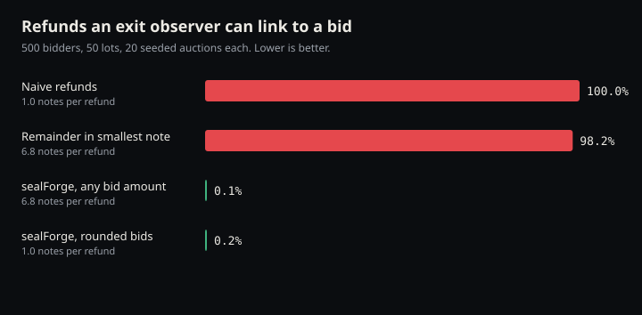

Status: `Testnet` for the planner, batching and signing ([06 Verification](/verification#testnet-record)). The linkability figures are a simulation (`Tested`), not a measurement of testnet traffic.

Pure logic: `crates/sealforge-core/src/denominations.rs`, `crates/sealforge-core/src/refunds.rs`. Randomness and scheduling: `crates/sealforge-coordinator/src/refunds.rs`.

## Problem

After publish, the UIVK reveals every bid's amount, so anyone can compute each bid's refund. Refunds themselves are shielded. The leak is at the **exit**: when a bidder later unshields or swaps refund money on a public chain, that amount is public, and a unique amount points at one bid.

## Mechanism

| Step | Rule | Code |
|---|---|---|
| Denominations | Canonical values \{1, 2, 5\} × 10^k zatoshi from 10,000 zat (0.0001 ZEC) to 5,000 ZEC | `denominations::canonical_denominations`, `MIN_DENOMINATION`, `MAX_DENOMINATION` |
| Split | Greedy, largest first. Notes always sum to the refund minus dust | `denominations::split`, `refunds::split_refund` |
| Dust | The remainder below 10,000 zat is **not sent**. It stays in the escrow and leaves with the organiser's payout sweep. A database trigger enforces `sum(notes) = due − (due mod 10000)` | `refunds::refund_dust`; `migrations/20261015000000_refund_dust.sql`; payout in `crates/sealforge-coordinator/src/scanner.rs` |
| Threshold | Only bids with a refund ≥ 10,000 zat and a usable refund address are planned | `crates/sealforge-coordinator/src/refunds.rs` module doc |
| Delay | Each note gets its own delay, uniform in `[min, max]`, from `OsRng.next_u64()`. Default 10–240 minutes. Modulo bias over a span of hours against a `u64` is negligible | `RefundPolicy::default`, `plan_refund`; `OsRng` in `crates/sealforge-coordinator/src/refunds.rs` |
| Override | `SF_REFUND_DELAY_SECS="min,max"` shortens delays for demos on test networks. **Refused on mainnet** at startup | `crates/sealforge-coordinator/src/config.rs` `refund_policy` |
| Hold | Due notes wait until notes from at least 3 different bidders are due, or the oldest has waited 30 min, or nothing else is pending | `refunds::ready_to_batch`; `min_owners_per_batch = 3`, `max_hold_secs = 30 min` |
| Shuffle | Due notes are shuffled with `OsRng` before batching, so planning order doesn't leak | `due.shuffle(&mut OsRng)` |
| Batch | Round-robin across bidders, at most 20 outputs per transaction | `refunds::batch_due_notes`; `max_outputs_per_batch = 20` |
| No memo | Refund and payout outputs carry no memo | `PaymentOut { memo: None }` in `scanner.rs` |
| Pool | Escrow spends use an Ironwood-only change strategy, and refund addresses must have an Orchard receiver | [3 Zcash integration](/zcash-integration#no-transparent-or-sapling-hops) |

The 10,000 zat floor and the \{1, 2, 5\} shape match the denomination form in [ZIP 318](https://zips.z.cash/zip-0318) (Orchard to Ironwood Migration, Draft), which uses n × 10^k **ZEC** with n ∈ \{1, 2, 5\} over a different range for a different purpose. sealForge's scheme is its own and does not implement ZIP 318.

Tests: `refunds::tests::*` (`notes_are_canonical_and_sum_to_due_minus_dust`, `dust_is_not_sent`, `delays_stay_within_policy`, `batches_interleave_bidders`, `batches_wait_for_three_bidders_or_the_hold`, `batching_respects_max_outputs_and_keeps_every_note`), `denominations::tests::*`.

## Measurement methodology

Harness: `tools/linkability-harness` (`src/lib.rs` documents the model). Run with `cargo run -p sealforge-linkability --release -- --out docs/evidence`.

- **Adversary.** Sees every exit event's value (every refund note unshielded or swapped publicly) and tries to attribute each one to a bid. It knows every bid amount (the UIVK is public).
- **Worst case for bidders.** Every refund note is exited separately and immediately on arrival.
- **"Linked".** A bid is linked when at least one of its refund notes has a value no other refund note in that auction has. The observer can then attribute that exit to that bid with certainty.
- **Timing is not modelled.** Every note has an independent random delay, so arrival time carries no per-bid signal. In the naive flow, amounts already link about 100%.
- **Population.** Log-normal bids around a 0.5 ZEC median (σ = 1.0), uniform price, seeded and reproducible (`results_are_reproducible_for_a_seed`). Default 500 bidders, 50 lots, 20 auctions per scenario.

Scenarios: naive (one exact refund per bidder); remainder-in-smallest-note (the earlier design, where the sub-0.0001 remainder joined the smallest note); sealForge with any bid amount; sealForge with bids rounded as the UI suggests.

Results and other sizes are in [evidence/linkability.md](https://github.com/Udoka-AM/sealForge/blob/main/docs/evidence/linkability.md) (raw: `linkability.json`). The harness asserts the PRD target of under 5% (`sealforge_meets_the_ac13_target_and_naive_does_not`).

**The rejected variant.** Adding the remainder to the smallest note made one note per refund a unique value, so nearly every refund was linkable again. That's why dust is dropped rather than merged ([evidence/linkability.md §What we learned](https://github.com/Udoka-AM/sealForge/blob/main/docs/evidence/linkability.md#what-we-learned)).

## Known residuals

- **Exit all at once.** A bidder who exits all their notes together recreates the full refund amount and can be linked. The exit path SHOULD warn about this. ShieldRamp, where that warning would live, is not built.
- **Rare large refunds in small auctions.** An unusually large refund produces a large denomination that may be unique in the auction. This is the residual in the measured figures.
- **The bid itself is public after close.** The UIVK shows each bid's amount and refund address. Refund privacy protects the link between a refund exit and a bid, not the bid's amount.
- **Small or quiet pools.** Mixing within a batch and delays assume other activity. In an auction with few bidders, or when Ironwood traffic is low, timing analysis across the whole pool is not modelled ([11 Open questions](/open-questions)).
