Every place sealForge touches the Zcash protocol. Each entry gives: **what we use**, the **exact crate, version and function**, **why**, **what we deliberately don't do**, the **spec**, and the **status**.

Versions are from `Cargo.lock` at the commit in the [changelog](/appendix/changelog). Pins and verification dates are in [`docs/VERSIONS.md`](https://github.com/Udoka-AM/sealForge/blob/main/docs/VERSIONS.md), the single source for versions. Spec titles are as listed in the [ZIP index](https://zips.z.cash/); see the [spec appendix](/appendix/specs).

## Contents

- [Shielded pool: Ironwood](#shielded-pool-ironwood)
- [No transparent or Sapling hops](#no-transparent-or-sapling-hops)
- [Unified Addresses, UFVK, UIVK](#unified-addresses-ufvk-uivk)
- [Escrow key construction](#escrow-key-construction)
- [Threshold signing](#threshold-signing)
- [PCZT](#pczt)
- [Fees](#fees)
- [Memos](#memos)
- [Payment requests](#payment-requests)
- [Light client protocol](#light-client-protocol)
- [Note encryption and scanning](#note-encryption-and-scanning)
- [Bidder wallet keys](#bidder-wallet-keys)
- [Witnesses and anchors](#witnesses-and-anchors)
- [Escrow wallet](#escrow-wallet)
- [Randomness](#randomness)
- [Network and consensus](#network-and-consensus)
- [Dependencies and upstream risk](#dependencies-and-upstream-risk)

---

## Shielded pool: Ironwood

- **What:** escrow and bid notes live in the Ironwood value pool, which uses Orchard keys and receivers. Escrow and wallet proofs use the `PostNu6_3` circuit. The scanner trial-decrypts **both** Orchard and Ironwood actions, so a bid paid from a wallet still on the Orchard pool is seen.
- **Code:** `orchard 0.16.0`. `OrchardCircuitVersion::PostNu6_3` in `crates/sealforge-chain/src/spend.rs` `circuit()` and `crates/sealforge-wallet/src/pay.rs` `circuit()`. Change strategy `ShieldedPool::Ironwood` in `spend.rs` `propose`. Scanner: `crates/sealforge-scan/src/lib.rs` (`OrchardVersion`, `IronwoodVersion` domains).
- **Why:** Ironwood is the current shielded pool on the target networks.
- **Not done:** the in-browser wallet counts and labels Orchard-pool notes it receives but doesn't spend them ([WALLET-INTEGRATION.md](https://github.com/Udoka-AM/sealForge/blob/main/docs/WALLET-INTEGRATION.md)). sealForge doesn't move funds between pools.
- **Spec:** [ZIP 258](https://zips.z.cash/zip-0258) (NU6.3 deployment), [ZIP 326](https://zips.z.cash/zip-0326) (NU6.3 consequences for wallets), [ZIP 2005](https://zips.z.cash/zip-2005) (Ironwood quantum recoverability). How the circuit and value pool behave is `orchard`'s, as specified there.
- **Status:** `Testnet`.

## No transparent or Sapling hops

- **What:** the escrow UA has **only** an Orchard receiver. Refund and payout addresses MUST decode as a Unified Address for the auction's network **with an Orchard receiver**. Sapling-only and transparent addresses are rejected.
- **Code:** `crates/sealforge-escrow/src/address.rs` `escrow_address` (`UnifiedAddress::from_receivers(Some(orchard), None, …)`). `crates/sealforge-coordinator/src/validate.rs` `shielded_ua` (`ua.has_orchard()`). At ingest, an unusable refund address is dropped: the bid counts, and its refund goes to manual review (SECURITY-REVIEW F2, test `records_payments_with_memo_level_checks`).
- **Why:** paying a Sapling address from Ironwood crosses pools, which reveals the amount on chain. Transparent outputs reveal everything. One malformed address would also make every refund batch it joined fail to build (F2).
- **Not done:** no transparent inputs or outputs in any bid, refund or payout flow.
- **Spec:** [ZIP 316](https://zips.z.cash/zip-0316) (receiver types).
- **Status:** `Testnet`.

## Unified Addresses, UFVK, UIVK

- **What:** each auction has one escrow UA, one UFVK and one UIVK, all encoded for the auction's network.
  - The **UFVK** stays private, encrypted at rest (`auctions.escrow_ufvk_enc`, `pgp_sym_encrypt` with `SF_DATA_KEY`). The coordinator uses it to scan and to build spends.
  - The **UIVK** is derived from the UFVK and published at `publish`. It contains the Orchard **external-scope** IVK only (`zcash_keys 0.17.0-pre.2` `UnifiedFullViewingKey::to_unified_incoming_viewing_key`, which calls `to_ivk(Scope::External)`). Auditors see every payment **to** the escrow. They don't see outgoing refunds and payout, or the escrow's internal-scope change.
- **Code:** `crates/sealforge-escrow/src/address.rs` `escrow_view_keys`. Publish: `crates/sealforge-coordinator/src/routes/auctions.rs` `publish` (decrypts the UFVK, stores `escrow_ivk`). A DB `CHECK` allows `escrow_ivk` only in `published`, `refunding` and `settled`.
- **Why:** selective disclosure. Publishing incoming-only viewing power is enough to recompute the result and doesn't expose who was refunded when.
- **Not done:** the UIVK is never rotated or scoped per time range. Once published, it is permanent ([5 Security](/security#trust-assumptions), [11 Open questions](/open-questions)).
- **Spec:** [ZIP 316](https://zips.z.cash/zip-0316).
- **Status:** `Testnet`.

## Escrow key construction

- **What:** the Orchard FVK is `ak ‖ nk ‖ rivk` (96 bytes).
  - `ak` is the FROST group verifying key from the trustees' DKG. Orchard requires the `ak` point to have ỹ = 0 (`orchard 0.16.0` `src/keys.rs`: "the corresponding public point (ak^ℙ) has ỹ = 0"). The ciphersuite enforces this: `reddsa 0.5.2` `frost::redpallas` negates key packages and the group key into even-Y form in its `post_dkg` hook (`into_even_y`).
  - `nk` and `rivk` are sampled by **the coordinator** with `OsRng`: 64 random bytes, the top two bits of each 32-byte value cleared so both encodings are below the Pallas field moduli, then accepted only if `orchard::keys::FullViewingKey::from_bytes` accepts the 96 bytes (rejection sampling, at most 64 tries).
- **Code:** `crates/sealforge-escrow/src/address.rs` `escrow_fvk`, called from `crates/sealforge-coordinator/src/routes/dkg.rs` `complete` as `escrow_fvk(&ak, &mut OsRng)` once all three trustees report the same public key package. `crates/sealforge-escrow/src/dkg.rs` `group_key_bytes`.
- **Why:** spend authority must be threshold-controlled, so `ak` comes from FROST. `nk` and `rivk` give viewing power, not spending power: they let the holder find and decrypt notes and compute nullifiers, and they are needed to build a spend, but they can't authorize one.
- **What it gives the coordinator:** because it samples `nk` and `rivk`, the coordinator always holds full viewing power over the escrow. That includes seeing deposit-mode bids live, and outgoing notes. It holds no signing share. See [5 Security](/security#trust-assumptions).
- **Not done:** `nk` and `rivk` are not jointly generated by the trustees, and not sampled by the organiser ([11 Open questions](/open-questions)).
- **Spec:** [ZIP 312](https://zips.z.cash/zip-0312) "FROST for Spend Authorization Multisignatures" covers threshold control of the spend authorization key. It **does not** specify how `nk` and `rivk` are generated (its Key Generation section states that it doesn't specify a key generation procedure), so sealForge's choice is its own. The Orchard key components are as in the protocol specification ([protocol.pdf](https://zips.z.cash/protocol/protocol.pdf)), handled by `orchard 0.16.0`.
- **Status:** `Testnet`.

## Threshold signing

- **What:** a 2-of-3 FROST DKG run on each trustee's machine ([4 Architecture](/architecture#dkg-relay-security)). For each escrow spend in a PCZT, the trustees sign `(shielded_sighash, α)`. The aggregated signature is a RedPallas `SpendAuth` signature that verifies under `rk = ak + [α]G`, and the coordinator applies it to the PCZT.
- **Code:**
  - DKG: `crates/sealforge-escrow/src/dkg.rs` (`frost::keys::dkg::part1/2/3`).
  - Signing: `crates/sealforge-escrow/src/signing.rs` `commit`, `sign`, `aggregate`. `sign` deserializes α into a `frost_rerandomized::Randomizer` and calls `frost_rerandomized::sign` (marked `#[allow(deprecated)]`, see [upstream risk](#dependencies-and-upstream-risk)). `aggregate` uses `RandomizedParams::from_randomizer`.
  - Consensus check: `signing::verify_spend_auth` verifies with `reddsa 0.6.1` `VerificationKey<SpendAuth>` after `ak.randomize(α)`, the same type `orchard 0.16` uses.
  - Application: `crates/sealforge-chain/src/spend.rs` `apply_signatures` (`pczt::roles::low_level_signer`), which checks each signature against the action's `rk` first.
- **Why:** no single party, the coordinator included, holds a key that can spend.
- **Not done:** trustees don't receive or check the PCZT before signing. They sign the sighash the coordinator gives them ([5 Security](/security#trust-assumptions)). No nonce reuse: nonces are deleted after round 2, and a reset round discards them.
- **Spec:** [RFC 9591](https://www.rfc-editor.org/rfc/rfc9591) (FROST), [ZIP 312](https://zips.z.cash/zip-0312) (rerandomized FROST for spend authorization), RedDSA / RedPallas spend authorization in the [protocol specification](https://zips.z.cash/protocol/protocol.pdf).
- **Tests:** `two_of_three_produces_consensus_valid_spend_auth_signatures` (every 2-of-3 subset; output verified with reddsa 0.6.1), `one_trustee_cannot_sign_alone`, `aggregates_posted_values_into_valid_signatures`, `browser_api_produces_valid_spend_signatures` (WASM signer), `dkg_e2e`.
- **Status:** `Testnet`. Regtest spike txid in [docs/spikes/frost-pczt.md](https://github.com/Udoka-AM/sealForge/blob/main/docs/spikes/frost-pczt.md).

## PCZT

- **What:** every escrow spend goes through the PCZT roles:

```mermaid
flowchart LR
    A[propose_transfer<br/>Zip317, Ironwood change] --> B[create_pczt_from_proposal<br/>Creator/Constructor]
    B --> C[IoFinalizer::finalize_io]
    C --> D[Prover::create_ironwood_proof<br/>PostNu6_3]
    D --> E[Signer::shielded_sighash]
    E --> F[low_level_signer:<br/>read α per escrow spend]
    F --> G[Trustees: FROST over sighash, α]
    G --> H[apply_signatures<br/>check vs rk, apply]
    H --> I[extract_and_store_transaction_from_pczt<br/>Spend finalizer + Tx extractor]
    I --> J[send_raw]
```

- **Code:** `crates/sealforge-chain/src/spend.rs`: `EscrowWallet::build_payment` / `build_sweep` → `prove` → `finalize`, `apply_signatures`, `send_raw`. `zcash_client_backend 0.25.0-pre.2` (`create_pczt_from_proposal`, `extract_and_store_transaction_from_pczt`) and `pczt 0.10.0-pre.2` (roles `io_finalizer`, `prover`, `signer`, `low_level_signer`). Dummy spends are signed by the IO finalizer. sealForge collects α only for actions whose `spend_auth_sig` is still empty (the escrow notes).
- **Why:** the PCZT separates building and proving (coordinator) from authorizing (trustees), and it carries α, which Orchard fixes per action.
- **Not done:** the PCZT isn't sent to trustees, though the coordinator stores it (`tx_batches.pczt`).
- **Spec:** [ZIP 374](https://zips.z.cash/zip-0374) "Partially Created Zcash Transaction Format" (Draft). Design notes: [docs/spikes/frost-pczt.md](https://github.com/Udoka-AM/sealForge/blob/main/docs/spikes/frost-pczt.md).
- **Status:** `Testnet`.

## Fees

- **What:** `StandardFeeRule::Zip317` with `MultiOutputChangeStrategy` (Ironwood change, split policy with a 10,000 zat minimum output). The bidder wallet asks the builder for the fee (`Builder::get_fee(&FeeRule::standard())`), so the quote matches what `build_for_pczt` checks. Escrow fees are paid from the escrow. The organiser can pre-fund a fee buffer (`SF1FEE`), and whatever isn't spent on fees returns with the payout. The payout sweep sizes itself by retrying with the shortfall the proposal reports (`build_sweep`).
- **Code:** `crates/sealforge-chain/src/spend.rs` `propose`, `build_sweep`. `crates/sealforge-wallet/src/pay.rs` `fee_for`. `crates/sealforge-core/src/memo.rs` `fee_buffer_memo`.
- **Not done:** no protocol fee ([9 Product](/product#revenue-models)).
- **Spec:** [ZIP 317](https://zips.z.cash/zip-0317) "Proportional Transfer Fee Mechanism".
- **Measured costs:** [9 Product, unit economics](/product#unit-economics).
- **Status:** `Testnet`.

## Memos

- **What:** ZIP 302 text memos. Bids carry `SF1`, reveals `SF1R`, the fee buffer `SF1FEE`. Refunds and payouts carry **no memo**. Grammar and limits: [2.3 Wire formats](/protocol/wire-formats).
- **Code:** encode: `zcash_protocol::memo::Memo::from_str` → `MemoBytes` (`spend.rs` `propose`); decode: `Memo::from_bytes`, `Memo::Text` only (`crates/sealforge-scan/src/lib.rs`). Parsing: `crates/sealforge-core/src/memo.rs`.
- **Not done:** no binary or structured (non-text) memo types.
- **Spec:** [ZIP 302](https://zips.z.cash/zip-0302).
- **Status:** `Testnet`.

## Payment requests

- **What:** one ZIP 321 URI and QR per bid, payable from any shielded wallet that supports ZIP 321 and memos.
- **Code:** `crates/sealforge-core/src/zip321.rs` `payment_uri`; `packages/bid/src/zip321.ts`. Format: [2.3](/protocol/wire-formats#zip-321-payment-uri).
- **Not done:** multi-payment URIs and other optional parameters.
- **Spec:** [ZIP 321](https://zips.z.cash/zip-0321) "Payment Request URIs".
- **Status:** `Testnet`.

## Light client protocol

- **What:** scanning is two-phase. First, trial-decrypt **compact blocks** to find which transactions pay the escrow. Then fetch each matching **full transaction** to decrypt the value, output index and memo. Natively over gRPC (`tonic 0.14`). In the browser over gRPC-web, through Envoy in front of Zaino.
- **Code:** `crates/sealforge-chain/src/audit.rs` `scan_incoming` (`get_block_range`, `get_transaction`). `crates/sealforge-scan/src/lib.rs` `scan_compact_block`, `decrypt_transaction`. Browser client: `apps/web/src/lib/grpc-web.ts`. Proxy: `infra/envoy.yaml`, `infra/envoy-tls.yaml`. The browser wallet also uses `GetLatestBlock`, `GetTreeState` and `SendTransaction`.
- **Why:** an auditor needs only a lightwallet server they choose. No full node, and no sealForge server.
- **Not done:** no full-node RPC dependency. The lightwallet server learns which blocks are fetched and the client's IP ([WALLET-INTEGRATION.md](https://github.com/Udoka-AM/sealForge/blob/main/docs/WALLET-INTEGRATION.md#privacy-notes-shown-to-users)).
- **Spec:** [ZIP 307](https://zips.z.cash/zip-0307) "Light Client Protocol for Payment Detection". The gRPC service is lightwalletd's `CompactTxStreamer`, as served by Zaino.
- **Status:** `Testnet` (CLI against `testnet.zec.rocks`; browser through `sealforge-lwd.udokaam.dev`).

## Note encryption and scanning

- **What:** incoming-only decryption with the UIVK for audits: `try_compact_note_decryption` on compact actions, then `try_note_decryption` on full actions, for both the Orchard and the Ironwood domain versions. Full decryption with the UFVK in the coordinator's escrow wallet.
- **Code:** `zcash_note_encryption 0.5.1`; `orchard 0.16.0` `note_encryption::{NoteEncryptionDomain, OrchardVersion, IronwoodVersion, CompactAction}` in `crates/sealforge-scan/src/lib.rs`. Escrow wallet: `zcash_client_sqlite 0.23.0-pre.2` via `crates/sealforge-chain/src/wallet.rs`.
- **Not done:** the auditor never uses the UFVK and never decrypts outgoing notes.
- **Spec:** note encryption in the [protocol specification](https://zips.z.cash/protocol/protocol.pdf), as implemented by `zcash_note_encryption` and `orchard`.
- **Status:** `Testnet`.

## Bidder wallet keys

- **What:** a 24-word BIP-39 phrase from 32 bytes of `crypto.getRandomValues`, then `UnifiedSpendingKey::from_seed(params, seed, zip32::AccountId::ZERO)`. Each bid gets a fresh diversified UA with an **Orchard receiver only**. Change goes to the internal scope.
- **Code:** `crates/sealforge-wallet/src/keys.rs` (`from_phrase`, `address(index)`, `change_address`). Browser key storage: `apps/web/src/lib/wallet/vault.ts` (PBKDF2-SHA-256 with 600,000 iterations, then AES-GCM-256, in IndexedDB).
- **Not done:** no Sapling or transparent receivers. The seed is never sent to any server.
- **Spec:** [ZIP 32](https://zips.z.cash/zip-0032) "Shielded Hierarchical Deterministic Wallets", [ZIP 316](https://zips.z.cash/zip-0316).
- **Status:** `Testnet`.

## Witnesses and anchors

- **What:** the wallet keeps one incremental witness per received note, starting from the birthday's tree state (`GetTreeState`). After each block, if the server supplied a nonzero `chain_metadata` tree size for Orchard or Ironwood, the wallet's tree size MUST equal it, or scanning stops with `TreeMismatch`. A missed action is caught, and a note with a wrong witness is never spent. Reorgs are detected and handled by rescanning from the birthday. Spends use the Ironwood tree root as the anchor.
- **Code:** `crates/sealforge-wallet/src/lib.rs` (`TreeMismatch` check, `ScanError::Reorg`); `crates/sealforge-wallet/src/pay.rs` `builder` (`ironwood_anchor`). `incrementalmerkletree 0.9`. Test: `scanning_follows_the_chain_and_refuses_gaps_and_reorgs`.
- **Not done:** the check is skipped when the server reports a tree size of 0. The escrow wallet uses `zcash_client_sqlite`'s own tree handling instead.
- **Status:** `Testnet`.

## Escrow wallet

- **What:** a view-only `zcash_client_sqlite` account per auction, imported from the UFVK. It syncs from Zaino, proposes transfers and builds PCZTs. Wallet files live in an owner-only directory (0700, SECURITY-REVIEW F6).
- **Code:** `crates/sealforge-chain/src/wallet.rs` (`EscrowWallet::create`, `sync`, `received`), `crates/sealforge-chain/src/spend.rs`, `crates/sealforge-chain/src/cache.rs`.
- **Status:** `Testnet`.

## Randomness

Every secret or randomizer comes from an OS CSPRNG. `sealforge-core` has none by design.

| Use | Source | Code |
|---|---|---|
| Note randomness, proofs, bidder spend signing (bidder wallet) | `rand 0.10` `SysRng` | `crates/sealforge-wallet/src/pay.rs` `rng()` |
| Note randomness and proofs (escrow spends) | `rand 0.10` `SysRng` | `crates/sealforge-chain/src/wallet.rs` `rng()` |
| `nk`, `rivk` | `rand 0.8` `OsRng` | `crates/sealforge-coordinator/src/routes/dkg.rs` |
| FROST DKG secrets and signing nonces | caller's `RngCore + CryptoRng` (`OsRng` in the CLI) | `crates/sealforge-escrow/src/{dkg,signing}.rs`; `crates/sealforge-cli/src/trustee.rs` |
| DKG round-2 sealing | `crypto_box::aead::OsRng` | `crates/sealforge-cli/src/trustee.rs` |
| Auction codes, invite codes | `OsRng` | `crates/sealforge-coordinator/src/codes.rs` |
| Refund delays, batch shuffle | `OsRng` | `crates/sealforge-coordinator/src/refunds.rs` |
| Bid salts, API nonces, wallet phrase | `crypto.getRandomValues` | `packages/bid/src/receipt.ts`, `apps/web/src/lib/sfsig.ts`, `apps/web/src/lib/wallet` |

## Network and consensus

- **Testnet:** NU7 testnet through the public lightwallet server `testnet.zec.rocks` ([evidence/testnet-genesis.md](https://github.com/Udoka-AM/sealForge/blob/main/docs/evidence/testnet-genesis.md)). Testnet blocks ran at about 25 s; the [ZIP 218](https://zips.z.cash/zip-0218) 25-second spacing is listed as Proposed in the ZIP index.
- **Regtest:** Zebra and Zaino at the versions in [VERSIONS.md](https://github.com/Udoka-AM/sealForge/blob/main/docs/VERSIONS.md). Regtest activates up to NU6.3 only, because that Zaino version doesn't know NU7's consensus branch ID ([VERSIONS.md](https://github.com/Udoka-AM/sealForge/blob/main/docs/VERSIONS.md); configs in `infra/regtest/`, launcher `scripts/regtest.sh`).
- **Mainnet:** not run. `local-dkg`, `SF_REFUND_DELAY_SECS` and `SF_MIN_WINDOW_BLOCKS` are refused on mainnet.
- **Spec:** [ZIP 259](https://zips.z.cash/zip-0259) (NU7 deployment, Proposed), [ZIP 258](https://zips.z.cash/zip-0258) (NU6.3).

---

## Dependencies and upstream risk

sealForge depends on pre-release Zcash crates and on a FROST ciphersuite that upstream has moved. This table states what that costs.

| Dependency | Pin | Why this pin | Risk | Plan |
|---|---|---|---|---|
| `zcash_client_backend` / `zcash_client_sqlite` | `=0.25.0-pre.2` / `=0.23.0-pre.2` | First versions with Ironwood and NU7 support (verified 2026-10-14/15) | Pre-release APIs change between pre-releases. Exact pins stop silent upgrades | Move to the first stable releases. Re-run regtest and testnet evidence on upgrade |
| `zcash_keys` / `zcash_protocol` / `zcash_primitives` / `zcash_address` | `=0.17.0-pre.2` / `=0.11.0-pre.1` / `=0.31.0-pre.2` / `=0.14.0-pre.2` | Same | Same. `zcash_keys` uses the `unstable-frost` feature | Same |
| `pczt` | `=0.10.0-pre.2` | Has `shielded_sighash` and `apply_ironwood_signature`. [ZIP 374](https://zips.z.cash/zip-0374) is Draft | Format and role APIs may change | Same |
| `reddsa` (FROST ciphersuite) | `=0.5.2`, feature `frost`, renamed `reddsa-frost` | The FROST(Pallas, BLAKE2b-512) ciphersuite was removed in `reddsa 0.6`. The 0.6.1 crate page says rerandomized FROST support will be provided by the ZcashFoundation `frost` repository, which didn't publish it as of 2026-10-14 ([spike](https://github.com/Udoka-AM/sealForge/blob/main/docs/spikes/frost-pczt.md#library-choices)) | Custody path on an older crate line | Migrate when the RedPallas ciphersuite is published upstream |
| `frost-rerandomized` / `frost-core` | `=3.0.0` | What `reddsa 0.5.2` builds on | `frost_rerandomized::sign` is **deprecated** in 3.0.0, with the note "switch to sign_with_randomizer_seed(), passing a seed generated with RandomizedParams::new_from_commitments()" ([docs.rs](https://docs.rs/frost-rerandomized/3.0.0/frost_rerandomized/fn.sign.html)). sealForge needs it because Orchard fixes α in the PCZT, so the randomizer can't be derived from a seed | Keep the call isolated in `crates/sealforge-escrow/src/signing.rs` `sign` behind `#[allow(deprecated)]`. Move to an upstream API that accepts a fixed randomizer |
| Two `reddsa` versions | 0.5.2 (FROST) and 0.6.1 (what `orchard 0.16` verifies with) | They interoperate through 32-byte keys and 64-byte signatures | A divergence between them would break signing | Test `two_of_three_produces_consensus_valid_spend_auth_signatures` verifies FROST output with 0.6.1 on every CI run |
| Alternative considered: `zakura-reddsa-frost 3.0.0` | not used | Recorded in the spike (2026-10-14) as published 2026-10-13 with few downloads | Not chosen for a custody path at the time | Re-evaluate together with the upstream migration ([11 Open questions](/open-questions)) |
| `orchard` | `0.16` (lock `0.16.0`) | Ironwood value pool, `PostNu6_3` circuit | Circuit and proving-key changes require a rebuild of the WASM modules | Rebuild and re-pin the WASM `BUILD.json` on upgrade |

Not independently re-verified for these docs: the crates.io status of `zakura-reddsa-frost` (the registry page didn't return crate data when checked on 2026-11-13).
